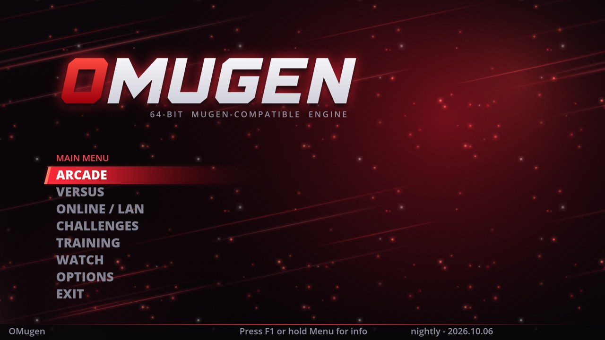
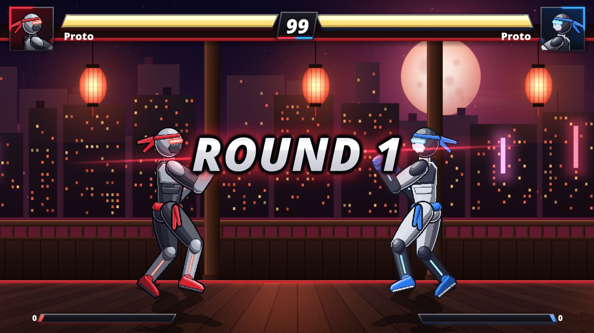
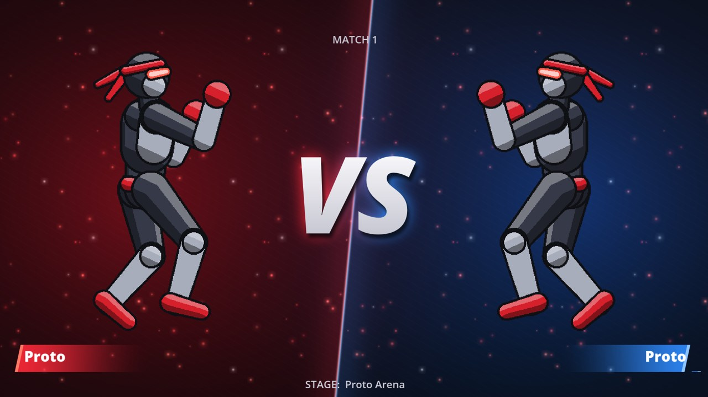
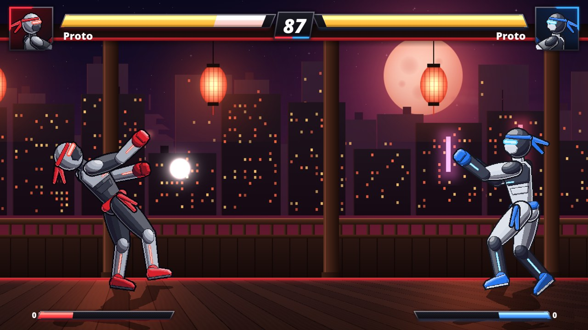
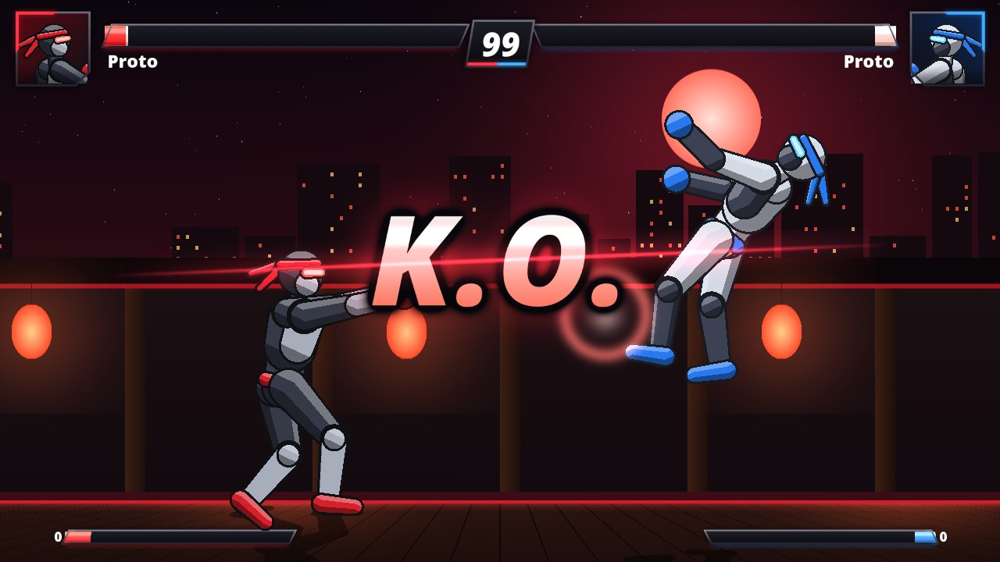
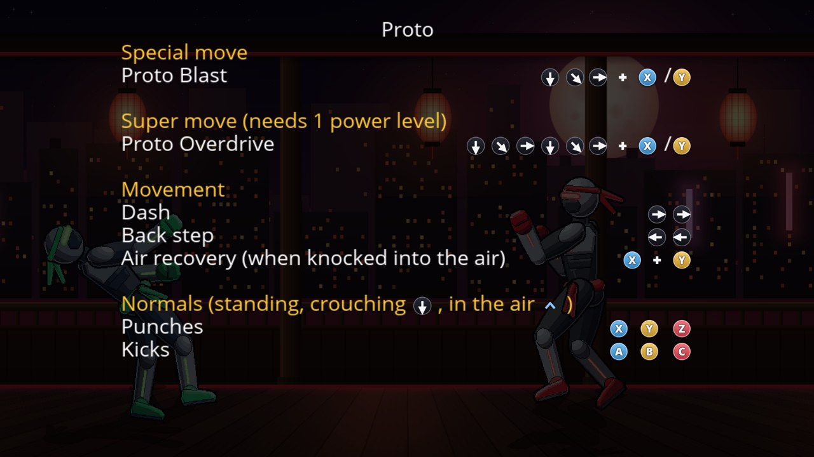

  

  <b>Your M.U.G.E.N game, unchanged, on a modern 64-bit engine.</b> 
  Drop <code>OMugen.exe</code> into any MUGEN 1.1 folder and play: same characters, stages,
  screenpack and controls. Nothing to convert.

  
  

## Why OMugen

- **One file, any MUGEN game.** Copy `OMugen.exe` next to `data`, `chars` and `stages`.
  The engine's own files live inside the exe; OMugen never changes the game's files and
  only adds a `save` folder.
- **Your controls, as they are.** Keys and pad buttons come from the game's `mugen.cfg`,
  with MUGEN 1.1's exact codes. Changes made in Options are written back to it.
- **Plug-and-play controllers for up to 4 players.** DualShock 4, DualSense and Xbox pads,
  over USB or Bluetooth, no DS4Windows needed. Players get the pads that send input, the
  light bar takes the player's color, and every menu shows who is selecting.
- **Fast with huge rosters.** A 1,580-character game reaches the menu in about 2 seconds.
- **Smooth on 120-240 Hz monitors.** The game still runs at 60 ticks per second and plays
  exactly the same; characters, camera and stages are drawn smoothly in between.
- **Online and LAN play**, delay-based or with rollback netcode.
- **Nothing breaks the game.** If a screenpack or lifebars fail to load, OMugen's own take
  over and say so. `OMugen.exe -doctor` checks every character and stage and writes a report.
- **Make your own game.** `OMugen.exe -newgame "My Game"` creates a playable game: a full
  template fighter, a stage, menus and lifebars, all in standard MUGEN formats.
- **On your phone too.** OMugen for Android plays the same game folders, with an
  on-screen DualShock 4 or Bluetooth controllers.

## OMugen and MUGEN 1.1

| | M.U.G.E.N 1.1 | OMugen |
|---|---|---|
| Runs on | 32-bit, Windows | 64-bit, Windows and Android (Linux builds: early) |
| Your game folder | as is | as is (OMugen adds only `save`) |
| Controls | `mugen.cfg` | the same `mugen.cfg` and codes, plus pads assigned automatically for up to 4 players |
| Above 60 fps | the game itself speeds up | up to 240 fps or the monitor's rate, same gameplay (checked tick by tick) |
| Online | no | online and LAN (delay-based or rollback netcode) |
| A broken screenpack or lifebars | error | OMugen's built-in ones take over |
| Checking a big game | one character at a time | `-doctor`: a report on every character and stage |
| Starting a new game | from an empty folder | `-newgame`: a playable template |

  
  
  

## Getting started

1. Download `OMugen.exe` from [Releases](../../releases) (or [build it](BUILDING.md)).
2. Copy it into your MUGEN 1.1 game folder, next to `mugen.exe`.
3. Run it.

Started outside a game folder, OMugen says where it belongs and offers to create a new game
of your own there instead.

The first start unpacks the engine files once to `%LOCALAPPDATA%\OMugen\engine\`, never
into the game folder. Settings, logs, replays and reports go to the game's `save` folder.
Files in the game folder always win over OMugen's built-in copies.

### On Android

1. Download `OMugen-<version>-android.apk` from [Releases](../../releases) and install it
   (Android asks you to allow installing apps from your browser or file manager once).
   Android 8 or newer, on 64-bit phones with OpenGL ES 3.2 (most phones since 2017).
2. Copy your MUGEN game folder (the one with `data`, `chars` and `stages`) into a folder
   named `OMugen` in your phone's internal storage. Too big for the phone? Leave it on a USB
   drive or SD card (Android 11+): OMugen finds games in an `OMugen` folder there or at the
   top of the drive, and **Add a game folder** picks any other folder. Games are played
   where they are, nothing is copied.
3. Open OMugen, tap **Allow file access**, then your game.

The settings under the game list choose the on-screen controller (a DualShock 4 drawn over
the game, with your pad layout) or Bluetooth controllers only, and the frame rate: 60 fps
saves battery, more is smoother on 90-144 Hz screens. The Back button works as Escape (the
pause menu in a fight, back in menus). If a game closes on an error, the app shows what
went wrong the next time it opens, and can share it.

## Features

- **Controls** come straight from `mugen.cfg`: keyboard keys (SDL 1.2 key codes) and
  joystick codes decoded from MUGEN 1.1 itself, so every button matches. Options > Input
  Settings shows and edits them in MUGEN's own notation (`A-17`...). The pad's
  Start/Options button opens the pause menu.
- **Controllers** are read through SDL and laid out the way MUGEN numbers them, so
  `mugen.cfg` codes keep their meaning (`OMUGEN_JOY=winmm` reads them exactly like MUGEN).
  Players get the controllers that actually send input, in the order they are first
  pressed; a player keeps the pad their own codes name. Pads that send nothing, and copies
  that mirror another pad (DS4Windows), are skipped. Players without joystick codes of
  their own play with player 1's layout. Options > Input Settings > Reassign Controllers
  hands them out again. `save/logs/controllers.txt` lists what OMugen sees.
- **Your pad layout follows you.** A game's joystick codes are numbered for the controller
  they were set up on; on another kind they can land on its triggers (a menu that scrolls
  by itself). Then OMugen uses your own layout for that kind of controller: the first one
  you played with, or the last one saved in Options (kept in
  `%LOCALAPPDATA%\OMugen\pad-layouts.ini`), or else the standard layout: left stick and
  D-pad to move, A B C on Square Triangle Circle, X Y Z on Cross R1 R2, MUGEN's Start
  (energy charge in many games) on L1, the pause menu on Options (Xbox pads by position).
- **Controller indicator:** P1-P4 tags in the corner show who has a controller, a notice
  appears when one joins, and the highlighted menu item shows who is selecting.
- **Screenpack, resolution, window and fullscreen** come from `mugen.cfg`; changes made in
  Options are saved back to it (a backup goes to `save/backups` first).
- **The game's own rules:** the first start takes life, round time, difficulty, game
  speed, team, volume, arcade AI and stage-fit settings from `mugen.cfg`, so the game plays
  as it does in MUGEN. Changes made later in Options are saved to both.
- **OMugen screenpack:** Options > Video Settings > OMugen Screenpack (or `-omugenui`). A
  1920x1080 interface that uses the game's characters, stages, lifebars, sounds and music,
  sizes the select grid to the roster and fits portraits of any size (cut like the game's own
  screenpack cuts them, for games that draw both sides' portraits in one picture).
- **OMugen lifebars:** used by new games and by any game whose lifebars fail to load. They
  bring the standard hit sparks and hit sounds MUGEN characters call by number.
- **OMugen Doctor:** `OMugen.exe -doctor` loads every character and stage in `select.def`
  the way a match does and writes `save/doctor/report.html` (errors, crashes, missing
  sprites, warnings). Options: `-doctor chars|stages`, `-doctorlimit N`,
  `-doctorfilter name1,name2`.
- **Frame rate:** Options > Video Settings > Frame Rate: 60 (default, like MUGEN), 120,
  144, 165, 240 or Monitor.
- **Glow:** Options > Video Settings > Glow Effects (off by default, like MUGEN).
- **Loading:** the roster's files are read in parallel and the sprite file headers are
  cached in `save/cache`, so big games start in seconds, even right after a reboot.

## Making your own game

`OMugen.exe -newgame "My Game"` creates a folder with everything a new fighting game needs,
ready to play and to change:

- **Proto**, a complete template fighter (an armored android martial artist): 6 palettes,
  normals on the ground and in the air, a projectile, a super move, a move list for the
  pause menu, and every standard animation the common states use, with collision boxes.
- **Proto Arena**, a rooftop dojo at night above a neon city, in six parallax layers
  (1280x720).
- Editable copies of the **OMugen screenpack** and **lifebars**, `data/select.def`, and
  the game's name as its window title.
- `GUIDE.txt`: how the files fit together and how to make characters, stages and menus.

Everything uses the MUGEN 1.1 formats, so MUGEN tools and tutorials apply.

  

## Made from code

Every image and sound OMugen ships is generated by its own tools, with no third-party art:

- `tools/screenpackgen`: the OMugen screenpack.
- `tools/lifebarsgen`: the lifebars, hit sparks, common sounds, engine effects and move
  list icons.
- `tools/templategen`: Proto and Proto Arena.
- `tools/logogen`: the logo and icons.

Other tools: `tools/mugenjoytest` shows the MUGEN joystick code of every button you
press; `tools/make_testgame.ps1` builds a zero-copy test folder from a MUGEN game; and
`-inputscript file` plays scripted input and takes screenshots, for automated tests.

## Building

See [BUILDING.md](BUILDING.md). In short: on Windows (MSYS2 MINGW64) or Linux, run
`build/omugen_build.sh` (`Win64`, `Linux` or, on Linux, `Android`). GitHub Actions builds
all three; pushing a version tag publishes them as a Release.

## Credits

OMugen's engine core comes from [Ikemen GO](https://github.com/ikemen-engine/Ikemen-GO) by
the Ikemen GO team and contributors (itself a rewrite of Suehiro's I.K.E.M.E.N); OMugen
builds its MUGEN drop-in compatibility, interface, tools and art on top of it.
M.U.G.E.N is by Elecbyte; OMugen is not affiliated with Elecbyte and contains none of its
code.

## License

MIT License: see [LICENCE.txt](LICENCE.txt), which keeps the copyright notices of
everyone whose code OMugen builds on, as the license requires. Bundled third-party
components keep their own licenses (Open Sans: Apache 2.0; FFmpeg: LGPL v2.1, dynamically
linked, rebuildable with `build/build.sh`), listed in the same file.
